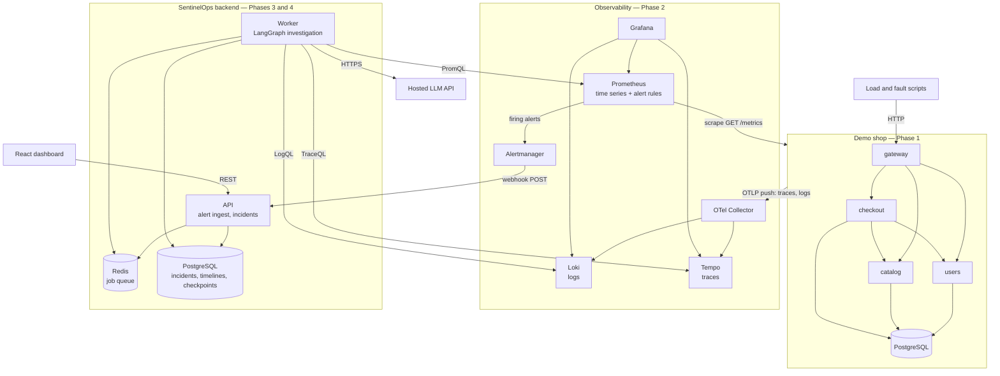
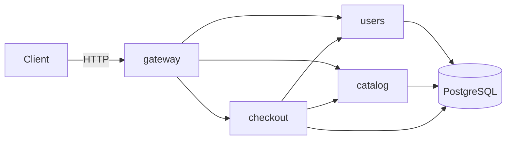
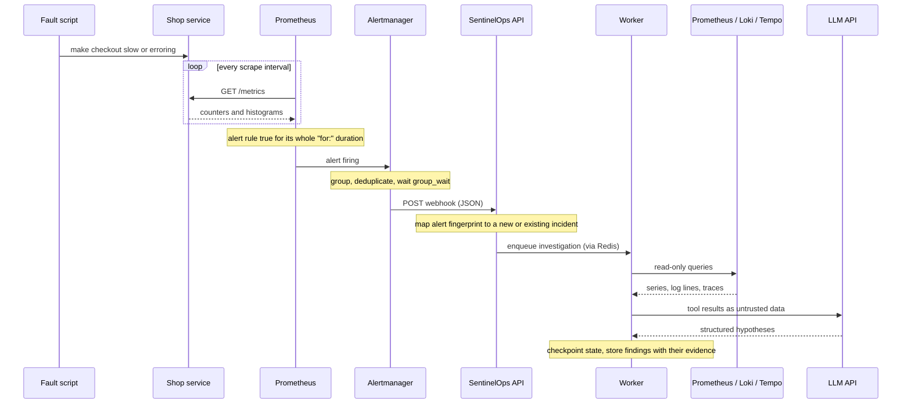

# Architecture

**Everything in this document is PROPOSED unless a status column says
otherwise.** Sections are relabelled as each part is built and verified.

## Reading the diagrams

Arrows point from the component that **opens the connection** to the one that
accepts it. That is the direction that matters when wiring networks: the
dialler needs the address, and the listener needs an open port. Data often
flows the other way — Prometheus dials a service, and the metrics come back.

## Overall architecture (PROPOSED)

## Demo shop (IMPLEMENTED as code, not yet containerized)

Four processes started from one Python package
([ADR-0002](adr/0002-shop-one-package-four-processes.md)). The gateway is the
only entry point and owns no data. users, catalog and checkout each own one
table in a shared PostgreSQL database and reach each other's data only over
HTTP. Every address is supplied through an environment variable.

The exact interface — start commands, environment variables, endpoints and
failure behaviour — is the connection contract in
[PROJECT_MAP.md](PROJECT_MAP.md). How these processes are packaged, networked
and started is Phase 1 work that has not been done yet.

## The path of one failure (PROPOSED)

Detection latency has a predictable floor: scrape interval + rule evaluation
interval + the rule's `for:` duration + Alertmanager's `group_wait`. We will
predict it and then measure it.

## Components

| Component | Responsibility | Phase | Status |
|---|---|---|---|
| Demo shop | A realistic target that can fail in interesting ways | 1 | **Code implemented**, verified as local processes on 2026-10-11; not yet containerized |
| Prometheus | Scrape metrics, store time series, evaluate alert rules | 2 | Proposed |
| OTel Collector | Receive traces and logs, forward them to stores | 2 | Proposed |
| Loki, Tempo | Store logs and traces | 2 | Proposed |
| Grafana | Human view over all three stores | 2 | Proposed |
| Alertmanager | Group and deduplicate alerts, deliver webhooks | 3 | Proposed |
| SentinelOps API | Alert ingest, incident lifecycle, REST for the dashboard | 3 | Proposed |
| SentinelOps worker | Run investigations off a job queue | 4 | Proposed |
| Dashboard | Show incidents and investigations | 3–4 | Proposed |

The SentinelOps backend is planned as a modular monolith: one API process and
one worker process sharing a codebase and a database. That choice is confirmed
or revised when Phase 3 starts.

## Network endpoints (PROPOSED)

These are each tool's documented default ports. All were free on the
development machine on 2026-10-11.

| Listener | Port | Protocol | Dialled by |
|---|---|---|---|
| Shop gateway | 8000 | HTTP | Load scripts, browser |
| Shop internal services | chosen when containerized | HTTP | Gateway, checkout |
| Prometheus | 9090 | HTTP | Grafana, SentinelOps worker |
| Alertmanager | 9093 | HTTP | Prometheus |
| OTel Collector | 4317, 4318 | OTLP over gRPC, OTLP over HTTP | Shop services |
| Loki | 3100 | HTTP | Collector, Grafana, worker |
| Tempo | 3200 | HTTP | Grafana, worker |
| Grafana | 3000 | HTTP | Browser |
| PostgreSQL | 5432 | PostgreSQL wire protocol | Shop services, SentinelOps |
| Redis | 6379 | RESP | SentinelOps API and worker |

How logs reach Loki — through the Collector, or through a separate log agent
reading container output — is decided in Phase 2.

## Security boundaries (PROPOSED)

- Investigation tools are read-only and typed. The LLM never receives a shell
  or raw credentials.
- Log lines, trace attributes and metric labels are attacker-influenced text.
  They are passed to the LLM as data and never as instructions.
- Remediation (Phase 6) goes only through versioned runbooks behind an
  approval step that the LLM cannot bypass.
- Secrets are supplied by the environment, never committed.

## Failure scenarios to design for

| If this is down | Expected behaviour |
|---|---|
| A shop dependency (users, catalog) | The caller times out or gets a connection error and returns a clear 5xx; it does not hang. **Implemented**: 502 and 504, see PROJECT_MAP.md |
| Prometheus | No new alerts. SentinelOps must surface "monitoring is blind", not silence |
| Alertmanager or the webhook | Alerts are retried by Alertmanager; ingest must be idempotent |
| Redis | Incidents are still recorded; investigations queue up or fail visibly |
| LLM API | The incident stays open with "investigation unavailable"; nothing is invented |

## Risks

| Risk | Why it matters | Mitigation | Revisit when |
|---|---|---|---|
| RAM: about 6 GiB was available at inspection | The full stack cannot run at once | Per-service memory limits, Compose profiles, measure before assuming (EXP-001) | A session swaps heavily |
| LLM cost | Hosted inference costs money per investigation | Explicit budget cap, recorded responses for tests, owner authorization before any spend | Phase 4 planning |
| No real incident data | ML and agent evaluation need labelled incidents | Every fault script writes a ground-truth record from Phase 1 on | Phase 5 planning |
| Prompt injection through logs | A crafted log line could steer the investigation | Tool output treated as data; adversarial test cases | Phase 4 |
| Scope creep | Ten phases invite building ahead | Phase gates; nothing built for a later phase | Every gate |

## Evolution

| Date | Change |
|---|---|
| 2026-10-11 | Initial proposal approved as the Phase 0 architecture |
| 2026-10-11 | Demo shop application code implemented as one package, four processes |
