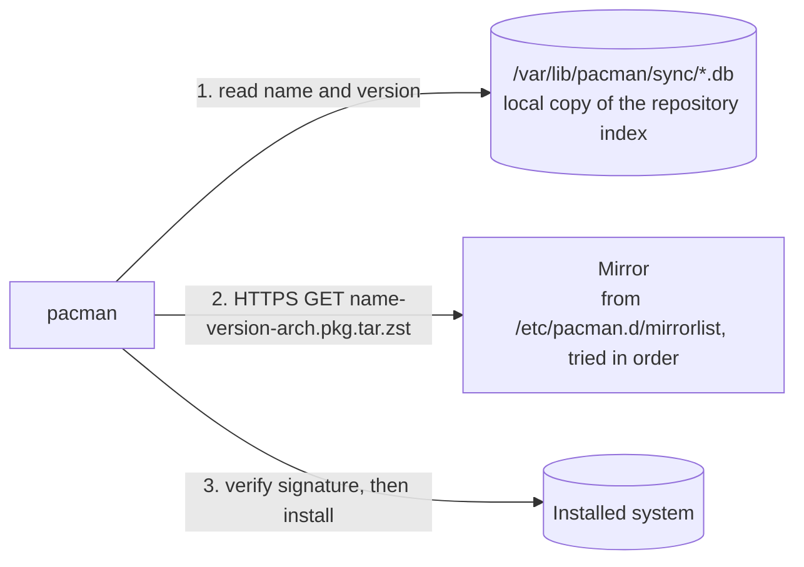

# Incidents and debugging

Real failures met while building or operating this project, and how each was
diagnosed. An entry records what was observed, not what was guessed; a fix
that has not been applied is marked **NOT RUN**.

| ID | Date | Title | Status |
|---|---|---|---|
| DBG-001 | 2026-10-12 | `pacman -S` fails with 404 from every mirror | Cause confirmed; fix **NOT RUN** |

---

## DBG-001: `pacman -S` fails with 404 from every mirror

- **Date:** 2026-10-12
- **Where:** the development machine, during task P0-2b (install Buildx and
  the packaged Compose plugin).
- **Status:** Root cause confirmed. The fix is the owner's to run and has
  **not been run**.

### Symptom

```text
$ sudo pacman -S docker-buildx docker-compose
Packages (2) docker-buildx-0.37.1-1  docker-compose-5.5.1-1
...
error: failed retrieving file 'docker-buildx-0.37.1-1-x86_64.pkg.tar.zst'
       from geo.mirror.pkgbuild.com : The requested URL returned error: 404
       (the same from about twenty other mirrors; one timed out instead)
error: failed to commit transaction (failed to retrieve some files)
Errors occurred, no packages were upgraded.
```

`docker buildx version` then answered `unknown command: docker buildx`.

### Impact

- Buildx is still not installed, so the shop image cannot be built yet.
- The hand-installed Compose plugin had already been moved to
  `~/docker-compose.manual-backup` by the next command in the same pasted
  block, so `docker compose` is unavailable as well until the fix is applied
  or the file is moved back.
- Running containers were not affected. Nothing was installed or upgraded:
  pacman downloads every file before it changes anything.

### How a package install is connected



The file name in step 2 is built from the version in step 1. A mirror keeps
only the current build of each package. If the local index is older than the
mirror, pacman asks for a file that has since been replaced, and every mirror
correctly answers 404. Pacman's only retry is the next mirror in the list.

### Checks and what they showed

| Check | Result |
|---|---|
| Age of the local index: `ls -l /var/lib/pacman/sync/` | `extra.db` dated 2026-09-23, 19 days old |
| Version the local index names: `pacman -Si docker-buildx` | 0.37.1-1 |
| Does a mirror have that file? `curl -I <mirror>/extra/os/x86_64/docker-buildx-0.37.1-1-x86_64.pkg.tar.zst` | HTTP 404 |
| What the mirror has now (directory listing) | `docker-buildx-0.38.0-1`, `docker-compose-5.6.0-1` |
| Last index refresh: `/var/log/pacman.log` | 2026-09-23, by a `pacman -Sy --needed <packages>` with no upgrade |
| Pending upgrades, computed against a private copy of a fresh index | 561 packages, about 2.3 GiB to download, including `linux` 7.2.6 → 7.2.9, `nvidia-open`, `systemd`, `glibc`, `docker` 29.8.1 → 29.9.0 |

### Root cause

The local package index was 19 days old. It named package builds that the
mirrors had already replaced.

`docker-compose-5.5.1-1` did download, from one mirror that had not yet
dropped the old file. That was luck, not a different cause.

### Contributing factor

The agent's instructions for P0-2b gave `pacman -S` without first checking
how old the package index was, and put the `mv` of the working Compose plugin
in the same block as an install it depended on. A pasted block does not stop
at the first failure, so the working plugin was moved even though its
replacement never arrived.

### Fix — NOT RUN

Refresh the index and upgrade the whole system in one transaction, adding the
two new packages, then reboot because the kernel and the NVIDIA driver are
among the upgrades:

```bash
sudo pacman -Syu docker-buildx docker-compose
```

Refreshing the index without upgrading (`pacman -Sy <package>`) is the
tempting shortcut and the wrong one. Arch has no stable release: a package is
built against the libraries that are current on the day it is built. A new
package on top of 19-day-old libraries is a partial upgrade, which Arch does
not support.

Checked before recommending this, on 2026-10-12:

- Arch news since the last full upgrade: one item (2026-09-22, mkinitcpio 42
  and TPM2 unlocking of LUKS devices). It does not apply to how this machine
  is set up.
- Free space: 83 GiB on `/`, 774 MiB on `/boot`.
- The other project's three containers have restart policy `unless-stopped`
  and the Docker service is enabled at boot, so they should return after the
  reboot. To be verified.

### Verification — NOT RUN

To be filled in from the owner's output: `uname -r`, `docker version`,
`docker buildx version`, `docker compose version`, `docker ps`, `nvidia-smi`.

### Prevention

- On Arch, install with `-Syu <package>`, or run `-Syu` first. Never `-Sy`
  followed later by `-S`.
- In instructions, a step that removes something working goes after the
  check that its replacement works, not in the same block.
