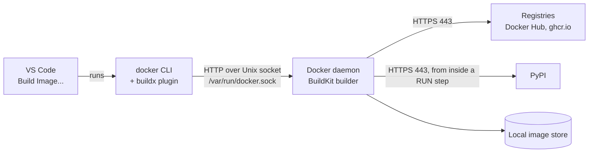

# Docker images, layers and the build cache

The lesson for task P1-2. Written 2026-10-12. Everything under "Real
example" was read from the development machine that day. The exercises are
the owner's and are **NOT RUN** until their results are recorded in
[LEARNING_JOURNAL.md](../LEARNING_JOURNAL.md).

## What an image is

An image is a read-only package holding everything a program needs to run
except the kernel: an interpreter, libraries, your code, and a small
configuration record. It has three parts.

| Part | What it holds |
|---|---|
| Layers | An ordered list of archives. Each one is a set of file changes on top of the layer below |
| Config | A JSON record: default command, environment variables, working directory, user |
| Manifest | The list of the layers and the config, each named by the SHA-256 of its content |

A **tag** such as `python:3.14-slim` is a name that points at one manifest.
The name can be moved to point at a different manifest later. The SHA-256
**digest** cannot: it is computed from the content.

A **container** is one image plus a thin writable layer plus a process. Start
ten containers from one image and the image's layers are stored once.

## Why it exists

Before images, "deploying" meant making a server look like the developer's
machine: the right interpreter, the right libraries, the right versions. An
image moves that work to build time. The bytes that were tested are the bytes
that run.

## How it works inside

**Instructions become layers.** A Dockerfile is a list of instructions.
`FROM`, `RUN`, `COPY` and `ADD` change files, so each produces a layer. `ENV`,
`WORKDIR`, `USER`, `CMD`, `EXPOSE` and `LABEL` only edit the config and add
no files.

**Layers are stacked, never edited.** The kernel's overlay filesystem shows
the stack as one directory tree. Two consequences:

- Deleting a file in a later layer hides it; the bytes stay in the earlier
  layer and the image does not shrink. A secret copied in and then deleted is
  still in the image.
- Layers are shared. Two images built on the same base store that base once,
  and a pull or push transfers only the layers the other side lacks.

**The build cache.** Before running a step, the builder asks whether it has
already run exactly this step on exactly this starting point:

- For `RUN`, "the same" means the same instruction text. The builder does not
  know or care that the internet has changed since.
- For `COPY`, "the same" means the same file contents. Modification times do
  not count.

If the answer is yes, the stored layer is reused. The first step that misses
forces every step after it to run again, because each later step starts from
a different point. So the order of instructions decides how long rebuilds
take: put what changes rarely at the top and what changes often at the
bottom.

**The build context.** The builder runs inside the Docker daemon, not in your
shell, so it cannot see your files. The client packs up one directory, the
build context, and sends it. `COPY` can only reach files inside the context.
A `.dockerignore` file at the root of the context lists what to leave out.

## What came before

| Approach | What it lacked |
|---|---|
| Installing by hand or by shell script | Not repeatable; servers drift apart |
| Configuration management (Ansible, Chef, Puppet) | Repeatable steps, but applied to a long-lived server that still accumulates differences |
| Virtual machine images | The whole operating system: gigabytes to move, minutes to start |
| Language packaging (virtualenv, wheels) | Captures Python packages but not the system libraries under them |

Docker combined kernel features that already existed, namespaces, cgroups
and overlay filesystems, with a layered image format and a registry to share
images through.

## Why this project uses it, and the alternatives

Every later phase consumes images: Compose in Phase 1, Kubernetes in the lab
track and Phase 7, the registry and pipeline in Phase 8.

| Alternative | Why not here |
|---|---|
| Podman and Buildah | Same image format and Dockerfile syntax, no daemon. A fair choice; Docker Engine is already installed and is what Compose and kind expect by default |
| Buildpacks | Build an image with no Dockerfile. Hides the mechanics this project exists to teach |
| Nix | Fully reproducible builds; a large subject of its own |

## How a build is connected



| Hop | Protocol and address | Authentication | Configuration | When it fails |
|---|---|---|---|---|
| VS Code → `docker` CLI | A local process; the command is printed in the terminal panel | None | Extension settings | The terminal shows the error |
| CLI → daemon | HTTP over `/var/run/docker.sock` | File permission: owner `root`, group `docker`. Membership of `docker` is equivalent to root on this machine | Docker context | `permission denied` or `Cannot connect to the Docker daemon` |
| Daemon → registry | HTTPS, port 443 | Anonymous for public images; Docker Hub limits how many anonymous pulls it allows | The image name in `FROM` | `pull access denied`, `manifest unknown`, or a rate-limit message |
| `RUN` step → PyPI | HTTPS, port 443 | None for public packages | The lockfile | The step exits non-zero and the build stops there, naming the step |
| Daemon → image store | Local disk | — | — | `no space left on device` |

Nothing leaves the machine until an image is pushed. A `RUN` step that
fails is not run again by the builder; a tool inside the step may retry by
itself.

## Real example

`python:3.14-slim`, as it sat on this machine on 2026-10-12:

```text
$ docker history python:3.14-slim
SIZE      CREATED BY
0B        CMD ["python3"]
16.4kB    RUN /bin/sh -c set -eux;  for src in idle3 p…
42MB      RUN /bin/sh -c set -eux;   savedAptMark="$(a…
0B        ENV PYTHON_SHA256=c2215904f02b175596dc493515…
0B        ENV PYTHON_VERSION=3.14.8
13.2MB    RUN /bin/sh -c set -eux;  apt-get update;  a…
0B        ENV PATH=/usr/local/bin:/usr/local/sbin:/usr…
87.6MB    # debian.sh --arch 'amd64' out/ 'trixie' '@1…
```

Read from the bottom up: a Debian base, system packages, Python itself, a
few symlinks. Four lines have a size and are layers; four are `0B` and only
edited the config. `docker image inspect` reports four layers, no user set
(so it runs as root) and the default command `python3`.

**A tag that moved.** The same day, the copy on this machine and the copy on
Docker Hub had different digests under the same name:

| Where | Digest of `python:3.14-slim` |
|---|---|
| This machine (image created 2026-10-01) | `sha256:0741d101…` |
| Docker Hub | `sha256:a2b82f3c…` |

The maintainers had rebuilt the image and moved the tag. This is why VS Code
adds `--pull` to its build command: without it, the builder uses whatever
the tag meant on the day you first pulled it.

## Exercise

### Part 1 — read an image `[ME — OPERATIONS]`

In VS Code open the Containers view, expand Images, find `python` →
`3.14-slim`, right-click and choose Inspect. In a terminal run
`docker history python:3.14-slim`. Find the default command, the user and the
Python version, and match each line of the history to "layer" or "config
only".

### Part 2 — write the shop's Dockerfile `[ME — OPERATIONS]`

Create `services/shop/Dockerfile` and `services/shop/.dockerignore`. The image
must meet these requirements; how is your decision.

| # | Requirement |
|---|---|
| R1 | One image serves all four services. The service is chosen by the command given at run time, for example `uvicorn shop.users.app:create_app --factory` |
| R2 | Based on the official slim Python 3.14 image |
| R3 | Dependencies come from `uv.lock` exactly, without the `dev` group: no pytest or ruff in the image |
| R4 | Editing a file under `src/` and rebuilding must not download the dependencies again |
| R5 | The process runs as a non-root user with a fixed numeric user ID |
| R6 | Nothing about any environment is in the image: no addresses, no `DATABASE_URL`, no secrets |
| R7 | The build context is `services/shop/`, and `.dockerignore` keeps `.venv/`, caches and `tests/` out of it |
| R8 | Tagged `sentinelops/shop:dev` |

The instructions you will need:

| Instruction | What it does |
|---|---|
| `FROM image:tag` | The starting image |
| `WORKDIR /path` | Create the directory if needed and make it current for later steps |
| `COPY src... dest` | Copy from the build context into the image. `COPY --from=image` copies out of another image instead |
| `RUN command` | Run a command in the image and keep the file changes as a layer |
| `ENV NAME=value` | Set an environment variable for later steps and for the running container |
| `USER name-or-id` | Run later steps and the container as this user |
| `CMD ["program", "arg"]` | The default command when a container starts with none given |

Hints about uv, which is this project's tool and not a Docker concept:

- uv is one binary, and its maintainers publish it as an image, so it can be
  copied in: `COPY --from=ghcr.io/astral-sh/uv:0.13.0 /uv /bin/uv`.
- `uv sync` creates `.venv` in the working directory. `--locked` fails if the
  lockfile does not match `pyproject.toml`, `--no-dev` leaves out the dev
  group, and `--no-install-project` installs the dependencies but not the
  shop package itself, so it needs only `pyproject.toml` and `uv.lock`.
- Programs installed by uv live in `.venv/bin`.
- The full reference is uv's own guide, "Using uv in Docker".

To build from VS Code, right-click the Dockerfile and choose Build Image...,
then enter the tag. The command appears in the terminal panel:

```text
docker build --pull --rm -f "services/shop/Dockerfile" -t sentinelops/shop:dev "services/shop"
```

| Part | Meaning |
|---|---|
| `--pull` | Ask the registry whether the base image's tag has moved |
| `--rm` | A leftover from the older builder |
| `-f` | Which Dockerfile |
| `-t` | The name and tag to give the result |
| Last argument | The build context. VS Code uses the Dockerfile's own folder |

Undo: `docker image rm sentinelops/shop:dev` removes the image, and
`docker builder prune` empties the build cache.

## Verification

Run each check and compare with what the requirement predicts.

| # | Command | What a correct image does | Proves |
|---|---|---|---|
| 1 | `docker run --rm sentinelops/shop:dev python -c "import shop.gateway.app, shop.checkout.app; print('ok')"` | Prints `ok` | The package and its dependencies are installed |
| 2 | `docker run --rm sentinelops/shop:dev id` | A uid that is not 0 | R5 |
| 3 | `docker run --rm sentinelops/shop:dev pytest --version` | Fails: not found | R3 |
| 4 | `docker run --rm sentinelops/shop:dev uvicorn shop.users.app:create_app --factory` | Exits at once with a configuration error naming `DATABASE_URL` | R1 and R6 |
| 5 | Build again with no changes | Every step reports `CACHED` | The cache works |
| 6 | Add a blank line to a file under `src/`, build, then `git checkout -- <file>` | Only the steps from the source copy onward run | R4 |
| 7 | `docker history sentinelops/shop:dev` and `docker image ls sentinelops/shop` | You can point at the dependency layer and the source layer, and read the total size | You can read your own image |

`--rm` on `docker run` deletes the container when it exits, so these checks
leave nothing behind.

## Debugging

| Symptom | Likely cause | Look at |
|---|---|---|
| `failed to compute cache key ... not found` | The file is not in the build context: wrong context folder, or excluded by `.dockerignore` | The last argument of the build command; `.dockerignore` |
| "transferring context" runs to hundreds of megabytes | `.venv/` is being sent | `.dockerignore` |
| Dependencies download on every build | A `COPY` of files that change often sits above the install step | The order of the instructions |
| `executable file not found in $PATH` | The program is in `.venv/bin`, which is not on `PATH` | `ENV PATH` |
| uv reports the lockfile is missing or out of date | `uv.lock` was not copied before `uv sync`, or `pyproject.toml` changed without `uv lock` | The `COPY` before the install step |
| Network errors inside a `RUN` step | The builder cannot reach PyPI | Whether the host itself can; then build again |
| `Permission denied` when the container starts | Files are owned by root and the run-time user cannot read or write them | Where `USER` sits relative to the steps that create files |

To look inside an image, start a shell in it:
`docker run --rm -it sentinelops/shop:dev bash`. To see what the cache holds:
`docker buildx du`.

## Knowledge check

1. `RUN apt-get update` is cached from a build three months ago. What does
   today's build do with that step, and why can that be a problem?
2. A Dockerfile copies the whole project and then installs dependencies. You
   change one line of Python. What reruns, and why?
3. A secret file is copied into an image and deleted in the next instruction.
   Can someone with the image read it? Why?
4. Why can `COPY ../../README.md .` not work, however the path is written?
5. Two machines pull `python:3.14-slim` a month apart. Are they certain to
   have the same image? What would make them certain?
