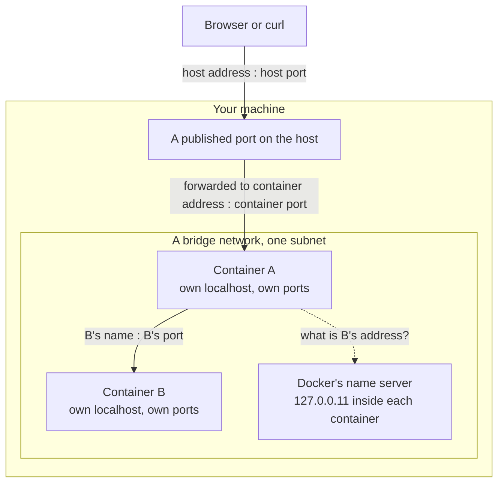
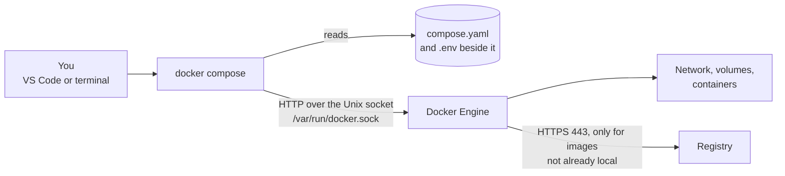

# Docker networking and Compose

The lesson for task P1-3. Written 2026-10-13. Everything under "Real
example" was read from the development machine that day. The exercise and
the verification checks are the owner's and are **NOT RUN**; the "what a
correct stack does" column is a prediction until results are recorded here.

## What they are

**Container networking** is how a container gets an address and how
anything reaches it. **Compose** is a tool that reads one file describing
several containers, their network and their storage, and makes Docker match
that file.

Four facts carry most of this lesson.

1. **Every container has its own network.** Its own interfaces, its own IP
   address and its own `localhost`. Inside the gateway container,
   `localhost` means the gateway container and nothing else.
2. **Containers on the same Docker network can dial each other** by IP
   address, on any port the other one is listening on.
3. **On a network you create, Docker also answers name lookups.** A
   container can dial another by name and Docker supplies the current IP.
4. **Nothing outside can dial in unless a port is published.** Publishing
   makes the host forward one of its own ports to a port in one container.

## Why they exist

The image you built contains a program. A running shop is five programs
that have to find each other: four services and a database. Started by hand
that is five long `docker run` commands, in the right order, with a network
created first and every address typed correctly each time. Compose turns
that into a file that can be read, reviewed, committed and run with one
command.

## How it works inside

### One container, one network namespace

A container is an ordinary Linux process whose view of the system has been
narrowed. One of the things narrowed is the network: the kernel gives the
process a **network namespace**, a private copy of the network stack with
its own interfaces, routing table and port numbers. Because the port numbers
are private, two containers can both listen on the same port number without
colliding.

### A bridge network is a virtual switch

`docker network create` makes a **bridge**: a virtual switch inside the
kernel, with a subnet of private addresses. When a container joins, Docker
creates a virtual cable (a *veth pair*) with one end in the container, where
it appears as `eth0` with an address from that subnet, and the other end
plugged into the bridge.



### Names

On a network you create, each container's `/etc/resolv.conf` points at
`127.0.0.11`, a name server Docker runs for that container. It answers with
the current IP of any container on the same network, looked up by container
name or, under Compose, by **service name**. This matters because a
container gets a new IP whenever it is recreated; the name is the stable
thing.

The network Docker creates at install time, called `bridge`, does not do
this. Containers on it reach each other only by IP.

### Publishing a port

`-p 127.0.0.1:8000:9000` reads "connections to port 8000 on this machine's
loopback address are forwarded to port 9000 in this container". Docker
implements it with packet-rewriting rules in the kernel. Three things follow:

- The left side is the host's; the right side is the container's. They need
  not be equal.
- With no address on the left (`-p 8000:9000`), Docker listens on every
  address the host has, which includes your Wi-Fi address. Other machines on
  the same network can then connect.
- Containers talking to each other never use the published port. They dial
  the container's own port directly.

### What Compose does

Compose is a client, like the `docker` command itself. It has no server of
its own.



`docker compose up` compares the file with what exists and creates or
replaces whatever differs:

- one network named `<project>_default`, which every service joins;
- the volumes the file names;
- one container per service, named `<project>-<service>-1`.

The **project name** is the folder containing the file unless the file sets
`name:`. Compose remembers nothing itself: it finds its containers again by
labels it put on them, such as `com.docker.compose.project`.

Values written as `${NAME}` in the file are filled in from the shell's
environment or from a file named `.env` in the same folder.

## What came before

- **Everything on the host network.** Each program takes a port on the
  machine; two things wanting the same port collide, and nothing is
  isolated.
- **`docker run --link`.** The first way to give one container another's
  address. It wrote entries into `/etc/hosts`, went stale when a container
  was recreated, and is now a legacy feature.
- **Shell scripts of `docker run` commands.** They work, but a script says
  how to create things, not what should exist, so running it twice or
  changing one service is awkward.
- **`docker-compose` version 1**, a separate Python program. The current
  `docker compose` is a plugin for the Docker client, which is the one
  installed here.

## Why this project uses it, and the alternatives

Decision D-003 chose Compose first and Kubernetes later.

| Option | Why not now |
|---|---|
| A script of `docker run` commands | No single description of the stack; hard to change one piece |
| Kubernetes from the start | Its networking adds Services, cluster DNS and kube-proxy on top of the ideas above. Those are easier to learn once this layer is familiar, and the lab track starts in Phase 2 |
| Podman with pods or systemd units | A sound alternative, but Docker is already installed and is what most references assume |

What carries over to Kubernetes: one address per unit, a name service that
maps a stable name to changing addresses, configuration injected as
environment variables, and nothing reachable from outside until you say so.

## How the shop's stack is connected

The application's side of every connection is fixed by the
[connection contract](../PROJECT_MAP.md#connection-contract). The stack
supplies the other side.

| Who dials whom | Protocol | Address used | Authentication | Where the address is configured | How failure shows | Timeouts and retries |
|---|---|---|---|---|---|---|
| You → gateway | HTTP | A published port on the host | None | `ports:` on the gateway | Connection refused or reset in the client | The client's own |
| gateway → users, catalog, checkout | HTTP | `http://<service name>:<container port>` | None | `USERS_URL`, `CATALOG_URL`, `CHECKOUT_URL` | 502 "unreachable", 504 "timed out"; a WARNING line in the gateway's log | 5 s per phase, no retry |
| checkout → users, catalog | HTTP | The same form | None | `USERS_URL`, `CATALOG_URL` | 502 or 504 from checkout, passed through by the gateway | 2 s per phase, no retry |
| users, catalog, checkout → database | PostgreSQL protocol over TCP | `<service name>:5432` inside `DATABASE_URL` | User name and password in `DATABASE_URL` | `DATABASE_URL` | 503 "database unavailable"; `/readyz` turns 503 | 3 s to connect; a pooled connection is tested before use; no retry |
| Any container → Docker's name server | DNS | `127.0.0.11`, port 53 | None | Set by Docker | The dialling service reports "unreachable" | Resolver defaults |
| `docker compose` → Docker Engine | HTTP over a Unix socket | `/var/run/docker.sock` | File permissions on the socket | Docker context | "Cannot connect to the Docker daemon" | None |

Where data lives: PostgreSQL writes inside its container. A container's own
filesystem is deleted with the container, so the database's directory must
be a **volume**, storage that Docker keeps separately. `docker compose down`
removes containers and the network and keeps volumes; `down --volumes`
deletes them too.

Where the password lives: in `.env`, which `.gitignore` already excludes.
The Compose file refers to it as `${NAME}`. This repository is public, so a
password typed into `compose.yaml` would be published.

## Real example

Read on the development machine on 2026-10-13.

```text
$ docker network ls
NAME                DRIVER    SCOPE
bridge              bridge    local
host                host      local
<project>_default   bridge    local
none                null      local
```

| Network | What it is |
|---|---|
| `bridge` | The default network. Subnet `172.17.0.0/16`, gateway `172.17.0.1`, no containers on it. No name lookups |
| `host` | Not a separate network: a container started with it shares the machine's own network stack |
| `none` | A container with no network at all |
| `<project>_default` | Created by Compose for another project on this machine, whose name is replaced here. Three containers are on it |

That other project's `docker ps` output shows the three kinds of port line:

| `PORTS` column | Meaning |
|---|---|
| `5432/tcp` | The image declares the port. Nothing is published: only containers on the same network can reach the database |
| `127.0.0.1:N->N/tcp` | Published, to this machine only |
| `0.0.0.0:N->N/tcp` (not present here) | Published on every address of the host |

Before the exercise, none of ports 5432, 8000 to 8003 and 8080 was in use on
the host, and about 5.5 GiB of memory was available.

## Exercise

### Write the shop's Compose file `[ME — OPERATIONS]`

Create `compose.yaml` at the root of the repository, with `.env` and
`.env.example` beside it. The stack must meet these requirements; how is
your decision.

| # | Requirement |
|---|---|
| C1 | The project is named `sentinelops` |
| C2 | Five services: `db` from `postgres:18-alpine`, and `users`, `catalog`, `checkout` and `gateway` from the image `sentinelops/shop:dev`, which Compose can build from `services/shop` |
| C3 | Each shop service is started by its own command from the connection contract |
| C4 | Every address a service is given uses a service name. No IP addresses and no `localhost` |
| C5 | The database password is not in `compose.yaml`. It comes from `.env`, which is not committed; `.env.example` is committed with a placeholder |
| C6 | Only the gateway can be reached from the host, on port 8000, and only from this machine |
| C7 | The database's files are in a named volume and survive `docker compose down` |

Out of scope until later tasks: creating the tables (P1-4), health checks,
start-up order and memory limits (P1-5). At the end of this task the
database is empty, and that is expected.

The keys you will need:

| Key | What it does |
|---|---|
| `name:` | The project name |
| `services:` | One entry per container |
| `image:` | The image to run, and the tag given to an image Compose builds |
| `build:` | Where to build the image from: a context folder |
| `command:` | The command to start, replacing the image's default |
| `environment:` | Environment variables for the container |
| `ports:` | Published ports, written `"host address:host port:container port"` |
| `volumes:` under a service | Where a volume appears inside the container, written `name:/path` |
| `volumes:` at the top level | Declares the named volumes |

Hints:

- The official PostgreSQL image is configured through environment variables
  and documents them, and the directory to put a volume on, on its Docker
  Hub page. Read the section for the version you are running.
- The connection contract says who chooses each service's listening address
  and port.
- `docker compose config` prints the file as Compose understands it, with
  every `${NAME}` filled in. It is the first thing to run after any edit.

To run it from VS Code, right-click `compose.yaml` and choose Compose Up.
The command appears in the terminal panel:

```text
docker compose -f "compose.yaml" up -d --build
```

| Part | Meaning |
|---|---|
| `-f` | Which file |
| `up` | Create or update everything the file describes |
| `-d` | Detached: return the prompt and leave the containers running |
| `--build` | Build images that have a `build:` entry before starting |

Undo: `docker compose down` removes the containers and the network.
`docker compose down --volumes` also deletes the database's data.

## Verification

| # | Command | What a correct stack does | Proves |
|---|---|---|---|
| 1 | `docker compose config` | Prints the resolved file with no warning about an unset variable | The file parses; C5 is wired |
| 2 | `docker compose ps` | Five services, all running | C2, C3 |
| 3 | `docker network inspect sentinelops_default` | Five containers, each with an address in one subnet | C1, and that they share a network |
| 4 | `docker compose exec gateway getent hosts users` | An address from that subnet | Name lookups work |
| 5 | `curl -i http://127.0.0.1:8000/healthz` | 200 | The published port reaches the gateway |
| 6 | `curl -i http://127.0.0.1:8000/api/products` | 500, and the catalog's log names a missing table | Three hops work: you → gateway → catalog → database. The tables arrive in P1-4 |
| 7 | `docker compose ps` and `ss -ltn` | Only the gateway shows a `->` mapping; the host listens on `127.0.0.1:8000` and on none of the other services' ports | C6 |
| 8 | `docker compose down`, `docker volume ls`, `docker compose up -d` | The volume is still listed after `down` | C7 |
| 9 | `git status` | `.env` is not listed; `.env.example` is | C5 |

## Debugging

Work from the outside in: is the container running, what did it log, can
its name be resolved, is anything listening where the caller dials.

| Symptom | Likely cause | Look at |
|---|---|---|
| A service is `exited` in `docker compose ps` | The program stopped. The reason is its last log line | `docker compose logs <service>` |
| `ConfigError ... Field required` in a log | A variable from the connection contract was not given | `environment:` for that service; `docker compose config` |
| Compose warns that a variable is not set and defaults to blank | `.env` is missing, misnamed, or not beside `compose.yaml` | `docker compose config` |
| 502 "unreachable" from the gateway | The name does not resolve, the port is wrong, or the target is not listening where the caller dials | Check 4 for the name; the target's start-up log line for the address and port it listens on |
| `curl` to the host port: connection refused | Nothing is published on that port, or the container is not running | `docker compose ps`, the `PORTS` column |
| `curl` to the host port: connection reset, or an empty reply | The port is published but nothing answers behind it | The target's start-up log line |
| 503 "database unavailable" | Wrong host, port, user or password in `DATABASE_URL`, or the database container is not running | The service's ERROR line, which carries the driver's reason; `docker compose logs db` |
| The database container exits at once | The image prints why. Read all of it | `docker compose logs db` |
| `port is already allocated` | Something on the host already uses that port | `ss -ltnp` |
| A change to the file has no effect | The containers were not recreated | `docker compose up -d` again; it recreates what changed |

To run a command inside a running service:
`docker compose exec <service> <command>`. To follow one service's log:
`docker compose logs -f <service>`.

## Knowledge check

1. Inside the gateway container, what does `http://localhost:8000` point at?
   Why can it never be the users service?
2. Two containers both listen on port 8000 and neither fails to start. Why
   is that possible, and what would make it impossible?
3. The users service has no `ports:` entry. Can the gateway reach it? Can
   your browser? Why?
4. A service is recreated and gets a new IP. What keeps the others able to
   reach it?
5. What is the difference between `"8000:8000"` and `"127.0.0.1:8000:8000"`,
   and why does it matter for a service with no authentication?
6. `docker compose down` and then `up`: is the database's data still there?
   What decides that?
